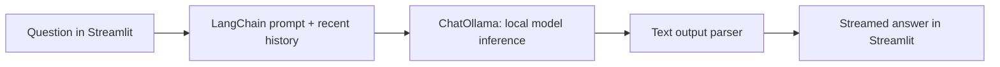

# Local Q&A Chatbot

A learning-focused conversational assistant built with **Streamlit**, **LangChain** and **Ollama**. Runs on your computer with streamed responses and temporary conversation memory. No paid model API key is needed for the default local model.

## Run with Docker

Install [Docker Desktop](https://docs.docker.com/desktop/setup/install/windows-install/) and start its Linux container engine. From this folder:

```powershell
docker compose up --build -d
```

The first start downloads the Ollama image and `llama3.2:1b` model (about 1.3 GB for the model alone). Allow additional disk space and memory for Docker and inference; speed depends on your CPU. This configuration uses CPU inference.

Check startup:

```powershell
docker compose logs model-pull
docker compose ps
```

Once the download finishes and the app is healthy, open **http://localhost:8501**. Ask “What is a language model?” and then “Explain that with an analogy” to exercise conversation memory. Use **Clear conversation** to reset.

```powershell
docker compose down
```

This stops the containers but retains downloaded models in a named volume. Do not use `down -v` unless you intend to delete that volume.

## Run with Python instead

Install Python 3.12 and [Ollama](https://ollama.com/download). Start Ollama, then:

```powershell
ollama pull llama3.2:1b
python -m venv .venv
.\.venv\Scripts\python -m pip install -r requirements.txt
.\.venv\Scripts\python -m streamlit run app.py
```

If Ollama is not already serving, run `ollama serve` in a separate terminal. Native mode reads shell environment variables, not `.env` files:

```powershell
$env:OLLAMA_MODEL = "llama3.2:1b"
$env:OLLAMA_BASE_URL = "http://localhost:11434"
```

For Docker customization, copy `.env.example` to `.env` and change the model there, then run `docker compose up --build -d` again.

## How it works



- **Streamlit** renders chat messages and owns session state.
- **LangChain** composes a prompt template, `ChatOllama`, and `StrOutputParser` using the `|` operator. It does not train the model.
- **Ollama** serves pretrained model weights and generates tokens locally.
- **Memory** means including recent messages in the next prompt. It does not modify model weights or create permanent learning.
- **Temperature** influences sampling. Lower values generally make answers more consistent, without guaranteeing truth.
- **Streaming** displays output as it arrives instead of waiting for the complete answer.

The app retains at most ten completed exchanges. It sends at most 6,000 characters of complete recent exchanges, accepts questions up to 2,000 characters and requests at most 512 output tokens. Character limits approximate resource bounds; they are not exact token accounting, particularly across languages. The model has an 8,192-token configured context.

## Project structure

| File | Purpose |
| --- | --- |
| `app.py` | Interface, streaming and session lifecycle |
| `chatbot.py` | Settings, input validation, history budgeting and chain |
| `tests/test_chatbot.py` | Chain and UI behavior without model downloads |
| `compose.yaml` | Ollama, model initialization and application |
| `Dockerfile` | Application container running as an unprivileged user |
| `.github/workflows/ci.yml` | Lint, tests, Compose validation and image build |
| `docs/DEPLOYMENT.md` | Hosted deployment and maintenance guidance |
| `docs/LEARNING.md` | Experiments and evaluation rubric |

## Quality checks

```powershell
.\.venv\Scripts\python -m pip install -r requirements-dev.txt
.\.venv\Scripts\python -m ruff check .
.\.venv\Scripts\python -m pytest -q
```

Python dependencies are pinned in the generated requirements files. To intentionally update them, install `pip-tools`, edit the `.in` files, run `pip-compile requirements.in` and `pip-compile requirements-dev.in`, and rerun checks. The lock files were resolved on Python 3.12 / Windows; CI verifies installation and image building on Linux. Container tags are versioned but not immutable digests.

## Scope and limitations

This is a production-oriented **portfolio starter**, not a hardened public multi-user service. There is no authentication, durable database, distributed rate limiting, retrieval, tool execution or web browsing. It cannot answer questions about private documents unless you paste their text, and answers can be incorrect. System prompts are behavioral guidance, not a security boundary.

The default inference stays on the Docker network or localhost. Configuring a remote Ollama endpoint sends prompts there. App code does not intentionally log message contents; third-party libraries and infrastructure need separate review. Session history can reset on reload or restart.

The Ollama API is not published to the host. Streamlit binds only to the host loopback interface. See the deployment guide before public exposure.

## Publish on GitHub

Create an empty repository named `local-qa-chatbot` under `manishkrishna988` (without generated README files), then from this folder:

```powershell
git init -b main
git add .
git commit -m "Add local Q&A chatbot with tests and Docker deployment"
git remote add origin https://github.com/manishkrishna988/local-qa-chatbot.git
git push -u origin main
```

If this folder is already initialized, skip `git init`; if `origin` is already present, skip `git remote add`. Authenticate through Git's normal sign-in flow. Never put a token into source files or remote URLs. After pushing, inspect the **Actions** tab before claiming the build passes. GitHub Pages cannot run this Python and Ollama service.

Suggested repository description: “Local Q&A chatbot with LangChain, Streamlit and Ollama: streaming, bounded memory, automated tests and Docker deployment.”

## References

- [LangChain ChatOllama integration](https://docs.langchain.com/oss/python/integrations/chat/ollama)
- [Streamlit Docker deployment](https://docs.streamlit.io/deploy/tutorials/docker)
- [Ollama Docker setup](https://docs.ollama.com/docker)
- [Llama 3.2 1B model and license](https://ollama.com/library/llama3.2:1b)

Model weights have their own license and are not included in this repository.
